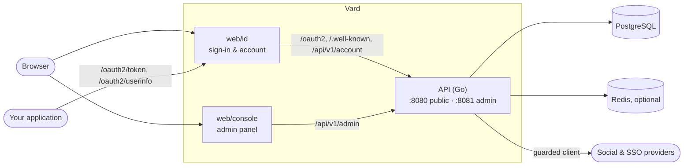
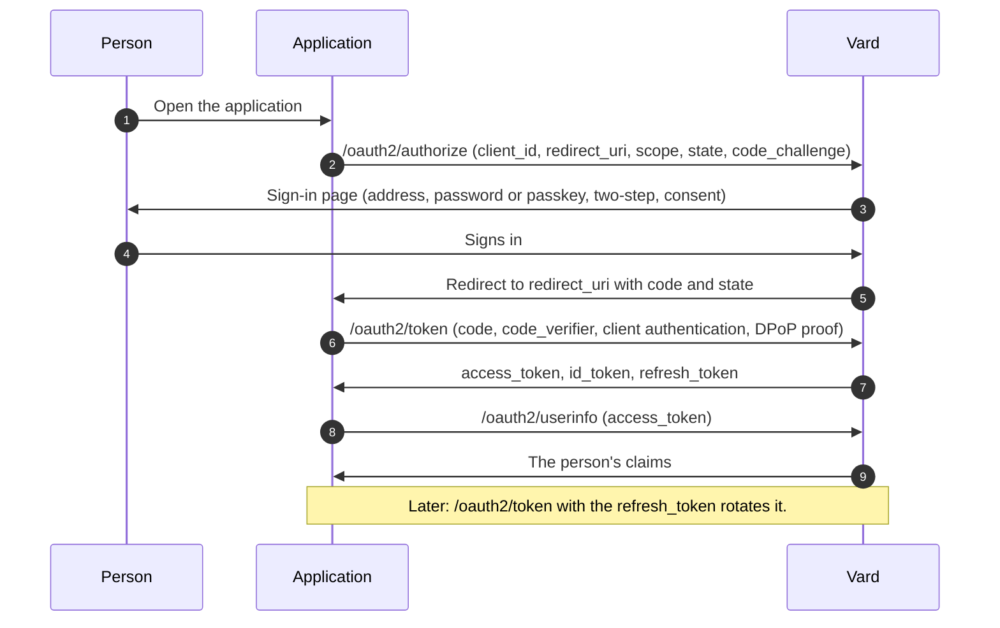

# Vard

An OAuth 2.0 authorization server and OpenID Connect provider in Go, with
hosted sign-in pages and an admin panel.

| Part          | What it is                                         |
| ------------- | -------------------------------------------------- |
| API (Go)      | The provider, the account API and the admin API    |
| `web/id`      | Sign-in pages and each person's own account        |
| `web/console` | The admin panel                                    |

## Features

- **OAuth 2.0:** authorization code with PKCE (always), PAR, device grant,
  client credentials, refresh rotation with reuse detection, token exchange
  (RFC 8693), dynamic registration, introspection (RFC 9701) and revocation.
- **DPoP:** sender-constrained tokens with server nonces and key-bound codes.
- **OpenID Connect:** ID tokens (RS256, PS256, ES256), userinfo, discovery,
  RP-initiated and back-channel logout.
- **Client profiles:** web, SPA, mobile, desktop and machine, each limited to
  what it may use (`docs/clients.md`).
- **Signing in:** login flows of on/off switches, passwords, emailed codes,
  passkeys, social providers (Google, Apple, Yandex, VK, any OIDC) and
  enterprise SSO (OIDC, SAML 2.0).
- **Two-step verification:** authenticator apps and passkeys, optional or
  required per flow.
- **Administration:** applications, APIs and scopes, users and roles, an
  activity log, languages, and roles for administrators.
- **Hardened:** sealed secrets, throttled (never locked) sign-in, strict
  redirect matching, guarded outbound calls, CSP and security headers.

## How it fits together



Each app is a SvelteKit server that renders its pages and passes the API's
paths on to it, so every origin is an app's and the API is never exposed.
Postgres holds everything; Redis is a cache and can be left out.

## How a sign-in works

The authorization code flow with PKCE, which every client uses:



- The **access token** is a signed JWT for an API (its `aud`), carrying the
  granted scopes and, where asked for, the person's roles.
- The **ID token** says who signed in and how (`amr`, `auth_time`).
- A **refresh token** is single-use: each refresh returns a new one, and a
  reused one revokes its family.
- Machines use `client_credentials` with `private_key_jwt`; TVs and command
  lines use the device grant.

## Quick start

Needs Go 1.27.4+, PostgreSQL 14+, [Bun](https://bun.sh), Node.js 24+ and,
optionally, Redis 6.2+.

```sh
make setup   # .env with a secret key, the database, dependencies
make dev     # the API and both apps, with hot reload
```

| Open                          | What                                    |
| ----------------------------- | --------------------------------------- |
| http://localhost:5174         | The admin panel: create the first admin |
| http://localhost:5173         | Sign-in pages and the account           |

`make docker-local` runs the production stack on ports 8080 (id) and 8081
(console). `make` lists every target.

## Docs and endpoints

| Where                                        | What                                           |
| -------------------------------------------- | ---------------------------------------------- |
| `/.well-known/openid-configuration`          | Discovery: every endpoint and what it supports |
| `/.well-known/jwks.json`                     | The public signing keys                        |
| `/api/v1/account/openapi.json` (id)          | The account API, OpenAPI 3.1                   |
| `/api/v1/admin/openapi.json` (console)       | The admin API, OpenAPI 3.1                     |
| `api/openapi/`                               | Both descriptions, the source of truth         |
| `docs/clients.md`                            | Integrating each kind of application           |
| `docs/threat-model.md`                       | What is protected, and how                     |
| `docs/adr/`                                  | Why things are the way they are                |
| `DEPLOY.md`                                  | A server, from DNS to backups                  |

The provider's endpoints, on the id origin:

| Endpoint                       | Does                                       |
| ------------------------------ | ------------------------------------------ |
| `/oauth2/authorize`            | Starts a sign-in                           |
| `/oauth2/par`                  | Pushes an authorization request (RFC 9126) |
| `/oauth2/token`                | Issues and refreshes tokens                |
| `/oauth2/device_authorization` | Starts a device sign-in (RFC 8628)         |
| `/oauth2/userinfo`             | The signed-in person's claims              |
| `/oauth2/introspect`           | Whether a token is active (RFC 7662)       |
| `/oauth2/revoke`               | Revokes a token (RFC 7009)                 |
| `/oauth2/register`             | Registers a client (RFC 7591)              |
| `/oauth2/logout`               | Signs out (RP-initiated logout)            |

Errors from the account and admin APIs are problem details (RFC 9457); the
OAuth endpoints answer with RFC 6749's `error`.

## Configuration

Settings are environment variables, read from `.env`; `.env.example`
documents each. The essentials:

| Variable               | Purpose                                                          |
| ---------------------- | ---------------------------------------------------------------- |
| `VARD_SECRET_KEY`      | Seals keys and secrets at rest. **Back it up.**                  |
| `VARD_DB_DSN`          | PostgreSQL                                                       |
| `VARD_ISSUER`          | The id app's public URL, the issuer                              |
| `VARD_ADMIN_URL`       | The console's public URL                                         |
| `VARD_REDIS_HOST`      | Redis; empty runs without                                        |
| `VARD_TRUSTED_PROXIES` | The apps' servers, the only callers trusted to say who calls     |
| `VARD_PASSKEY_RP_ID`   | The domain passkeys belong to; set it once, before the first one |

## Development

| Command                 | Does                                                      |
| ----------------------- | --------------------------------------------------------- |
| `make dev`              | Everything, with hot reload; logs in `.logs/`             |
| `make check`            | Lint, type-check and unit tests, Go and both apps         |
| `make test-integration` | The live tests against Postgres (and Redis if set)        |
| `make fmt`              | Formats everything                                        |
| `make generate`         | The apps' API types from `api/openapi/`                   |
| `make migrate-new`      | A new migration (`name=add_x`)                            |
| `make db-reset`         | A fresh local database (asks first)                       |

```
cmd/vard/          the binary: serve, migrate, admin create, keys reseal
internal/
  platform/        crypto, configuration, brand
  domain/model/    the concepts and their rules
  infrastructure/  store (every query), database, cache, mail, signing, …
  application/     the use cases: signin, oauth, oidc, federation, admin
  transport/http/  the routes and one package per subject
  app/             builds and runs it all
api/openapi/       the API descriptions
i18n/              the English that ships
web/id, web/console  the two apps
tests/integration/   the whole server over HTTP
```

## Third-party assets

- **Fonts:** Inter and JetBrains Mono, from @fontsource 5.3, under the SIL
  Open Font License 1.1 (`OFL.txt` beside each).
- **Icons:** [Remix Icon](https://remixicon.com) 4.8.0, Apache License 2.0;
  provider marks remain their owners' trademarks.
- **Favicons:** the apps' is the Svelte logo from SvelteKit's template; the
  API's and the panel's default logo are a placeholder "V".

## License

[MIT](LICENSE)
