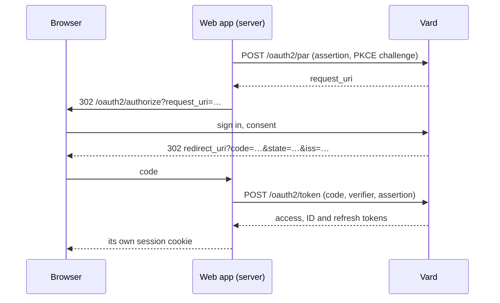
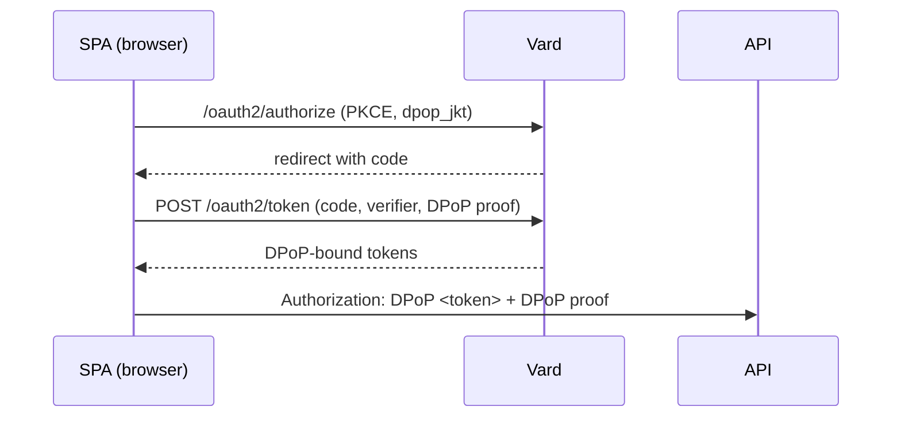
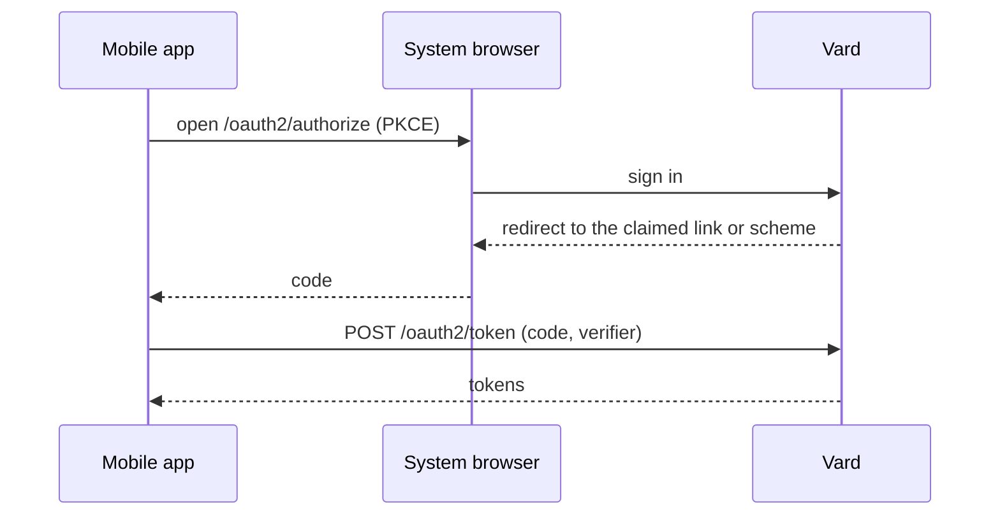
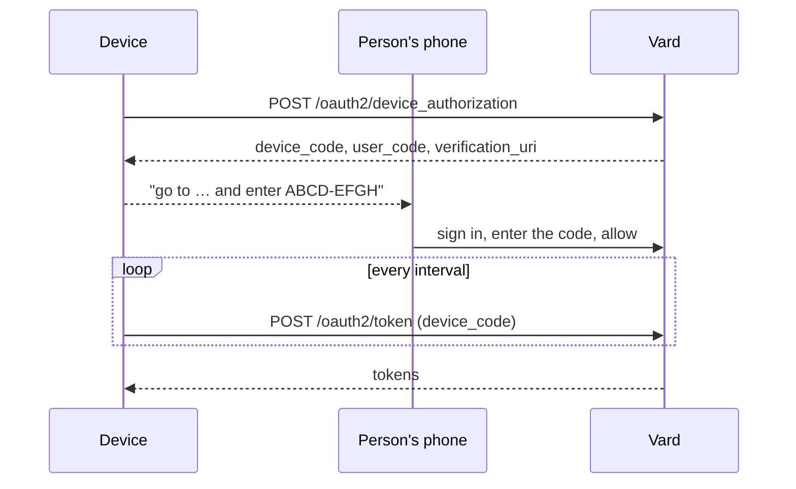
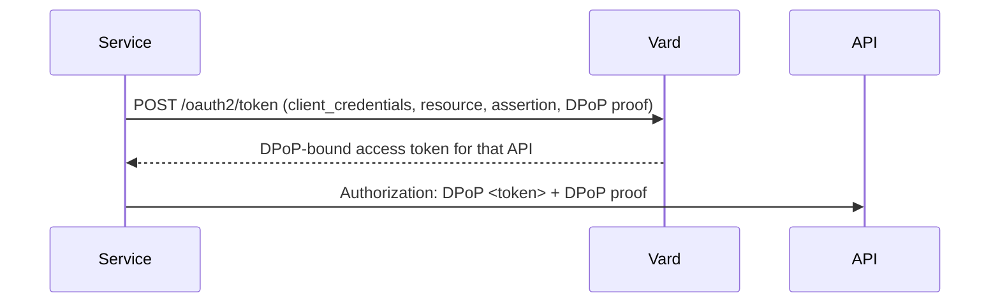
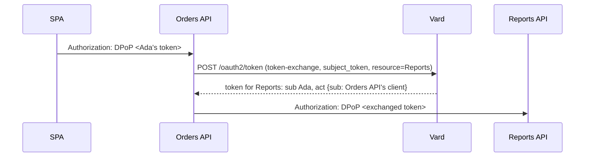

# Integrating a client

Every application is registered with one of five profiles (ADR 0005). The
profile decides what the application may use, and the server holds it to
that whatever else is edited. This guide is the path for each.

The server's addresses come from its discovery document,
`<issuer>/.well-known/openid-configuration`. Below, `ISSUER` is the
issuer (the sign-in app's address), and every endpoint is named as
discovery names it:

| Endpoint      | Path                           |
| ------------- | ------------------------------ |
| authorization | `/oauth2/authorize`            |
| token         | `/oauth2/token`                |
| PAR           | `/oauth2/par`                  |
| device        | `/oauth2/device_authorization` |
| userinfo      | `/oauth2/userinfo`             |
| revocation    | `/oauth2/revoke`               |
| introspection | `/oauth2/introspect`           |
| logout        | `/oauth2/logout`               |
| keys          | `/.well-known/jwks.json`       |

PKCE is always `S256`, for every client. A code is single-use, and a refresh
token is rotated on each use. A token for an API is asked for with
`resource=<the API's identifier>` (RFC 8707), at the authorization, PAR,
token or device endpoint: one per request, and its `aud` is exactly that.

## Signing a client assertion (`private_key_jwt`)

A web or machine client that authenticates with its own key sends, with any
request to the token, PAR, revocation, introspection or device endpoint:

```
client_assertion_type=urn:ietf:params:oauth:client-assertion-type:jwt-bearer
client_assertion=<JWT>
```

The JWT is signed with ES256, PS256 or RS256 (RSA keys 2048 to 4096 bits),
by a key whose public half the application registered, inline or at its
`jwks_uri`. Its claims:

| Claim        | Value                                                   |
| ------------ | ------------------------------------------------------- |
| `iss`, `sub` | the client_id                                           |
| `aud`        | `ISSUER` (the token endpoint's address is accepted too) |
| `exp`        | at most five minutes ahead                              |
| `jti`        | unique: an assertion is accepted once                   |
| `iat`        | optional                                                |

Sign a fresh one for each request. A key with a `kid` in its header is
looked up by it; a new key published at `jwks_uri` is picked up the first
time a token names it (at most one refetch a minute).

## Web application (BFF): `web`

A server-side application that keeps its tokens on the server and gives the
browser a cookie of its own.

- **Register:**
  - profile `web`;
  - `private_key_jwt` with its public keys (or `client_secret_basic` while
    it migrates);
  - grant `authorization_code`, and `refresh_token` if it keeps users
    signed in;
  - its exact `https` redirect URI;
  - a `backchannel_logout_uri`, to hear when a session ends.
- **Push the request (PAR), as recommended:**
  `POST /oauth2/par`, authenticated as the client, with:
  - `response_type=code`, `client_id`, `redirect_uri`;
  - `scope=openid …`, `state`, `nonce`;
  - `code_challenge`, `code_challenge_method=S256`.

  The answer is a `request_uri`.

- **Send the browser** to `/oauth2/authorize?client_id=…&request_uri=…`.
- **Exchange the code:** `POST /oauth2/token` with:
  - `grant_type=authorization_code`, `code`, `redirect_uri`;
  - `code_verifier`, and the client's authentication.
- **Keep the tokens on the server.** The browser never sees them.



## Single-page app: `spa`

A browser application with no backend. It has no credential.

- **Register:**
  - profile `spa`;
  - grant `authorization_code`, and `refresh_token` if it keeps users
    signed in;
  - its exact `https` redirect URI.
- **Send the browser** to `/oauth2/authorize` with:
  - `response_type=code`, `client_id`, `redirect_uri`;
  - `scope`, `state`, `nonce`;
  - `code_challenge`, `code_challenge_method=S256`;
  - `dpop_jkt`, to bind the code to its key.
- **Exchange the code** at `/oauth2/token`, from the page (CORS is open on
  the provider's endpoints), with:
  - `client_id`, `code`, `redirect_uri`, `code_verifier`;
  - a `DPoP` header proving its key (RFC 9449), which every token request
    of an SPA needs. The proof carries the server's nonce: the token, PAR
    and userinfo endpoints send one in `DPoP-Nonce` with every answer, and
    a proof without a current one is answered `use_dpop_nonce`, to send
    again with it.
- **Use the tokens:** they are bound to that key. Send each request with
  `Authorization: DPoP <token>` and a fresh proof. Keep the key
  non-extractable (WebCrypto).



## Mobile app: `native`

An iOS or Android app. It has no credential, and signs in through the system
browser (`ASWebAuthenticationSession`, Custom Tabs), never an embedded web
view (RFC 8252).

- **Register:**
  - profile `native`;
  - a claimed `https` redirect (Universal Links or App Links), or a
    private-use scheme such as `com.example.app:/callback`;
  - Expo Go's `exp://` only while in development, with "Allow development
    redirects" on.
- **Sign in:** as the SPA does, through the system browser, with PKCE and a
  DPoP key (every token request of a mobile app needs a proof).
- **Keep the refresh token** in the platform's keychain or keystore.
- **Passkeys:** passkeys made on the sign-in pages work in the system
  browser as they are. For the app to offer them too, list its iOS app IDs
  (`TEAMID.bundle.id`) and Android packages with their signing certificates'
  SHA-256 fingerprints on the application (Redirects). The sign-in origin
  then publishes them (`apple-app-site-association`, `webcredentials`;
  `assetlinks.json`, `get_login_creds`), and the app declares the
  associated domain on its side.



## Desktop app, command line or TV: `desktop`

No credential. Choose one of two ways.

- **With a browser on the same machine:**
  - register `http://127.0.0.1/callback` or `http://[::1]/callback`. Never
    `localhost`: a resolver may point it elsewhere (RFC 8252 §8.3).
  - Listen on any free port, and send `redirect_uri=http://127.0.0.1:<port>/callback`.
    It matches on any port, and in nothing else.
  - Sign in as the SPA does, with PKCE.
- **Without one (a TV, a terminal):** the device grant.
  - `POST /oauth2/device_authorization` with `client_id` and `scope`.
  - Show the person the `user_code` and `verification_uri`.
  - Poll `/oauth2/token` with
    `grant_type=urn:ietf:params:oauth:grant-type:device_code` and the
    `device_code`, every `interval` seconds, until the person allows it.



## Machine and agent: `machine`

A service, a job or an agent calling APIs as itself, with no user.

- **Register:**
  - profile `machine`, with its public keys: inline, or a `jwks_uri` it
    serves. It uses `private_key_jwt` and nothing else;
  - give it access to the APIs it calls (the API's page, Applications).
- **Get a token:** `POST /oauth2/token` with:
  - `grant_type=client_credentials`;
  - `resource=<the API's identifier>` (RFC 8707: one per request, and
    required), and optionally `scope`;
  - its assertion;
  - a `DPoP` header proving a key the service holds (RFC 9449), with the
    server's nonce, as the SPA's. Every machine's tokens are bound to its
    key.

  The token lives fifteen minutes at most, and there is no refresh token:
  ask again when it expires. Send it as `Authorization: DPoP <token>` with a
  fresh proof for each request.

- **The admin API's own client, `admin-cli`, is one of these.** It is made
  with no key: register the public key of the tool that uses it before
  calling the admin API.



## Acting for a user: token exchange (RFC 8693)

A service handed a user's token (say, an API called by the user's SPA) may
trade it for a token to another API, acting for the same user. It may only
when an administrator has added a rule on that API (APIs → the API →
Applications → Token exchange) naming the service, the application whose
tokens it is handed, and the scopes it may carry.

- **The service** is a web or machine application (it must authenticate).
- **Exchange:** `POST /oauth2/token`, authenticated as the service (with a
  DPoP proof if it is a machine), with:
  - `grant_type=urn:ietf:params:oauth:grant-type:token-exchange`;
  - `subject_token=<the token it was handed>` and
    `subject_token_type=urn:ietf:params:oauth:token-type:access_token`
    (or `…:id_token`, which carries no scope);
  - `resource=<the other API's identifier>`, and optionally `scope`;
  - optionally `actor_token` (`…:access_token`): a token the service got for
    itself, which must agree with how it authenticated.
- **The answer** is an access token (`issued_token_type` says so), never a
  refresh token. Its `sub` is the user; `act.sub` is the service, with the
  actor before it nested inside (at most three); its scope is what the
  handed token held and the rule allows, of the other API's scopes with the
  same names; it expires no later than the handed token, and ends when that
  token, its session or its family is revoked. An exchanged token may be
  exchanged again by a service a rule allows to act for this one.



## Checking a token at an API

An API (a resource server) is registered under APIs with an identifier, its
`resource`. It takes a token one of two ways.

|            | Local JWT check                                                                   | Introspection                                                                   |
| ---------- | --------------------------------------------------------------------------------- | ------------------------------------------------------------------------------- |
| Speed      | No call: the keys are cached                                                      | One call per token (cache it briefly)                                           |
| Revocation | Not seen until the token expires (an hour at most; fifteen minutes for a machine) | Seen at once: a revoked token, ended session or family, turned-off user         |
| Needs      | The JWKS                                                                          | A confidential client of the API's own, listed for it under Token introspection |

**Locally**, check every one of these, and refuse the token if any fails:

1. The JWT's header: `typ` is `at+jwt` (RFC 9068; an ID token is `JWT` and
   is never an access token), `alg` is the one the API is set to sign with
   (RS256 unless changed), never `none`.
2. The signature, by the key named by `kid` in `ISSUER/.well-known/jwks.json`.
   Fetch the set again only for a `kid` you do not hold, at most once a minute.
3. `iss` is exactly `ISSUER`.
4. `aud` holds the API's own identifier.
5. `exp` is in the future (allow a minute of clock skew at most), and `iat`
   is not in it.
6. `scope` holds what the route needs.
7. **If the token has `cnf.jkt`, it is bound to a key** (RFC 9449), and must
   arrive as `Authorization: DPoP <token>`, never `Bearer`, with a `DPoP`
   header holding a proof. Check that the proof:
   - is a JWT with `typ` `dpop+jwt`, an asymmetric `alg`, and its public
     key in `jwk` (with no private members);
   - is signed by that key, and the key's SHA-256 thumbprint (RFC 7638) is
     `cnf.jkt`;
   - has `htm` the request's method and `htu` its URL, without query or
     fragment;
   - has `ath` the base64url SHA-256 of the access token;
   - has an `iat` within a few minutes, and a `jti` not seen within them.
8. A token with `act` is one service acting for `sub` (token exchange):
   `act.sub` is the client acting, and any `act` nested inside it the ones
   before. Decide whether the route allows a delegated call.

**By introspection**, `POST ISSUER/oauth2/introspect` with `token=<the
token>`, authenticated as the API's listed client. The answer is
`{"active": false}` for anything not live, or `active: true` with the
token's claims: check `aud`, `scope` and `act` as above, and the DPoP proof
against `cnf.jkt` yourself, since introspection cannot see the request the
token came with. Send `Accept: application/token-introspection+jwt` to have
the answer signed (RFC 9701): a JWT with `typ` `token-introspection+jwt`,
`iss` the issuer, `aud` your client id, and the answer under
`token_introspection`, verified with the same keys.

## Logging out

- **From the application:** send the browser to `/oauth2/logout` with
  `id_token_hint` and a registered `post_logout_redirect_uri`. Without the
  hint, the person is asked first. Optionally:
  - `logout_hint`: the user's subject or email. A browser signed in as
    anyone else is signed out of nothing, and not asked.
  - `ui_locales`: the languages, most wanted first and space-separated, for
    the pages that ask and that say the person is signed out (behind a
    language the person picked themselves).
- **Being told:** an application with a `backchannel_logout_uri` gets a
  logout token, server to server, when a session it signed someone in
  through ends (OpenID Connect Back-Channel Logout): signed out, ended by
  an administrator, a password changed or reset, the user turned off or
  deleted. Answer 200 (or 204). Anything but a 4xx is tried again, waiting
  longer each time, for a day, so the endpoint may be down for a while
  without missing one; the same notice may, rarely, come twice. A session
  that simply expires sends none (ADR 0008). The panel shows each notice
  under the application's Logouts tab.
