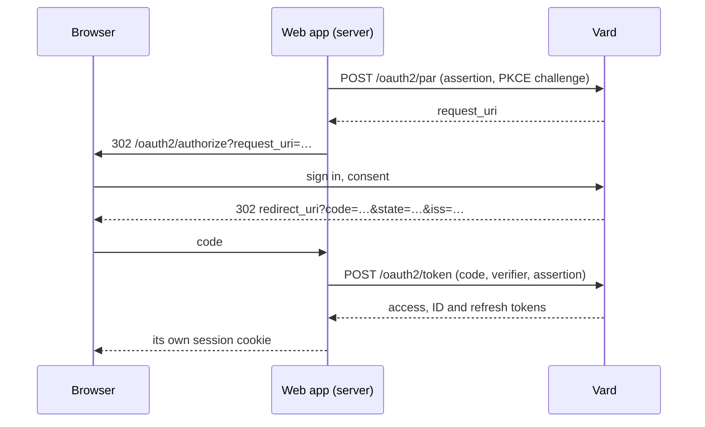
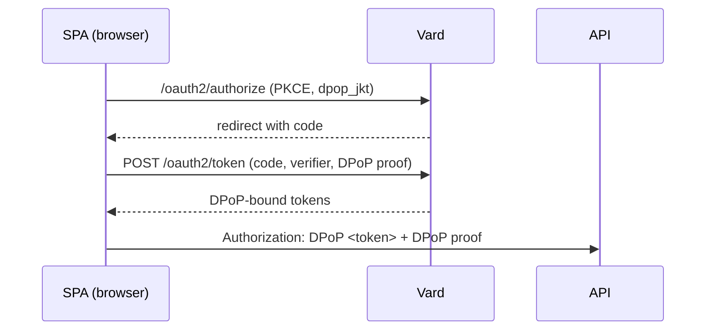
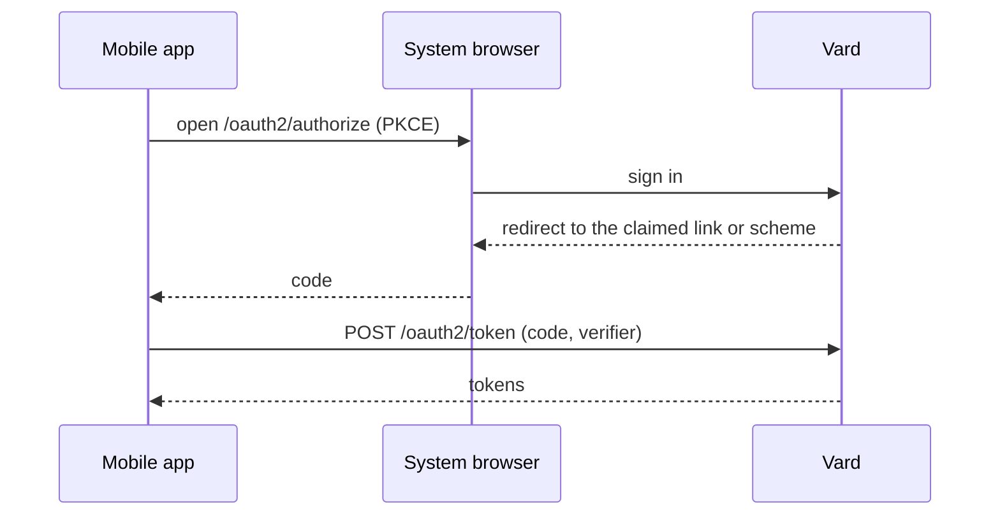
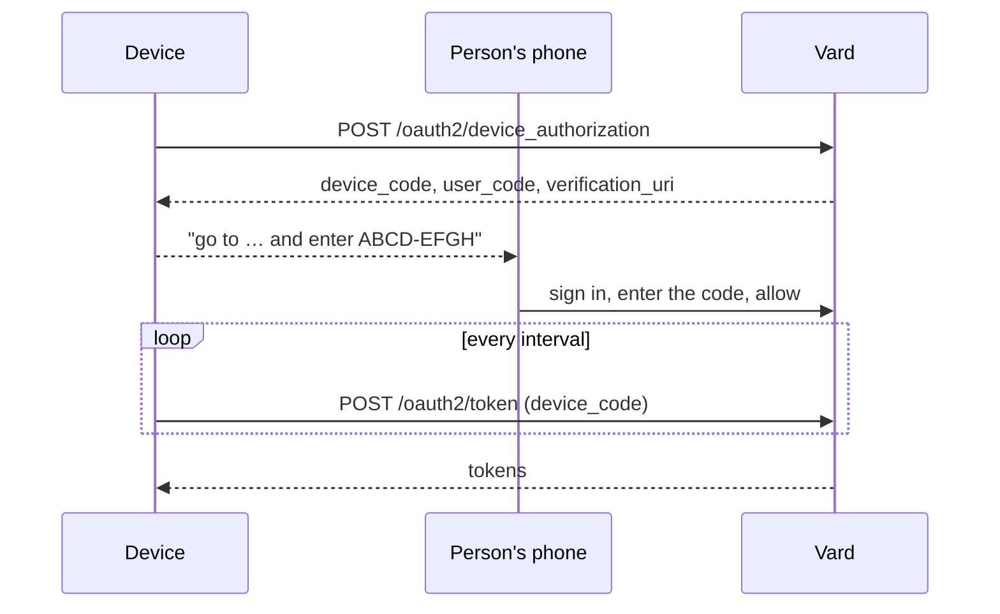
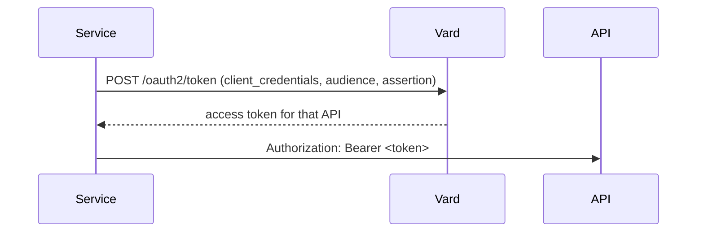

# Integrating a client

Every application is registered with one of five profiles (ADR 0005). The
profile decides what the application may use, and the server holds it to
that whatever else is edited. This guide is the path for each.

The server's addresses come from its discovery document,
`<issuer>/.well-known/openid-configuration`. Below, `ISSUER` is the
issuer (the sign-in app's address), and every endpoint is named as
discovery names it:

| Endpoint      | Path                           |
| ------------- | ------------------------------ |
| authorization | `/oauth2/authorize`            |
| token         | `/oauth2/token`                |
| PAR           | `/oauth2/par`                  |
| device        | `/oauth2/device_authorization` |
| userinfo      | `/oauth2/userinfo`             |
| revocation    | `/oauth2/revoke`               |
| introspection | `/oauth2/introspect`           |
| logout        | `/oauth2/logout`               |
| keys          | `/.well-known/jwks.json`       |

PKCE is always `S256`. A code is single-use, and a refresh token is rotated
on each use.

## Signing a client assertion (`private_key_jwt`)

A web or machine client that authenticates with its own key sends, with any
request to the token, PAR, revocation, introspection or device endpoint:

```
client_assertion_type=urn:ietf:params:oauth:client-assertion-type:jwt-bearer
client_assertion=<JWT>
```

The JWT is signed with ES256, PS256 or RS256 (RSA keys 2048 to 4096 bits),
by a key whose public half the application registered, inline or at its
`jwks_uri`. Its claims:

| Claim        | Value                                                   |
| ------------ | ------------------------------------------------------- |
| `iss`, `sub` | the client_id                                           |
| `aud`        | `ISSUER` (the token endpoint's address is accepted too) |
| `exp`        | at most five minutes ahead                              |
| `jti`        | unique: an assertion is accepted once                   |
| `iat`        | optional                                                |

Sign a fresh one for each request. A key with a `kid` in its header is
looked up by it; a new key published at `jwks_uri` is picked up the first
time a token names it (at most one refetch a minute).

## Web application (BFF): `web`

A server-side application that keeps its tokens on the server and gives the
browser a cookie of its own.

- **Register:**
  - profile `web`;
  - `private_key_jwt` with its public keys (or `client_secret_basic` while
    it migrates);
  - grant `authorization_code`, and `refresh_token` if it keeps users
    signed in;
  - its exact `https` redirect URI;
  - a `backchannel_logout_uri`, to hear when a session ends.
- **Push the request (PAR), as recommended:**
  `POST /oauth2/par`, authenticated as the client, with:
  - `response_type=code`, `client_id`, `redirect_uri`;
  - `scope=openid …`, `state`, `nonce`;
  - `code_challenge`, `code_challenge_method=S256`.

  The answer is a `request_uri`.

- **Send the browser** to `/oauth2/authorize?client_id=…&request_uri=…`.
- **Exchange the code:** `POST /oauth2/token` with:
  - `grant_type=authorization_code`, `code`, `redirect_uri`;
  - `code_verifier`, and the client's authentication.
- **Keep the tokens on the server.** The browser never sees them.



## Single-page app: `spa`

A browser application with no backend. It has no credential.

- **Register:**
  - profile `spa`;
  - grant `authorization_code`, and `refresh_token` if it keeps users
    signed in;
  - its exact `https` redirect URI.
- **Send the browser** to `/oauth2/authorize` with:
  - `response_type=code`, `client_id`, `redirect_uri`;
  - `scope`, `state`, `nonce`;
  - `code_challenge`, `code_challenge_method=S256`;
  - `dpop_jkt`, to bind the code to its key.
- **Exchange the code** at `/oauth2/token`, from the page (CORS is open on
  the provider's endpoints), with:
  - `client_id`, `code`, `redirect_uri`, `code_verifier`;
  - a `DPoP` header proving its key (RFC 9449).
- **Use the tokens:** they are bound to that key. Send each request with
  `Authorization: DPoP <token>` and a fresh proof. Keep the key
  non-extractable (WebCrypto).



## Mobile app: `native`

An iOS or Android app. It has no credential, and signs in through the system
browser (`ASWebAuthenticationSession`, Custom Tabs), never an embedded web
view (RFC 8252).

- **Register:**
  - profile `native`;
  - a claimed `https` redirect (Universal Links or App Links), or a
    private-use scheme such as `com.example.app:/callback`;
  - Expo Go's `exp://` only while in development, with "Allow development
    redirects" on.
- **Sign in:** as the SPA does, through the system browser, with PKCE.
- **Keep the refresh token** in the platform's keychain or keystore.



## Desktop app, command line or TV: `desktop`

No credential. Choose one of two ways.

- **With a browser on the same machine:**
  - register `http://127.0.0.1/callback` or `http://[::1]/callback`. Never
    `localhost`: a resolver may point it elsewhere (RFC 8252 §8.3).
  - Listen on any free port, and send `redirect_uri=http://127.0.0.1:<port>/callback`.
    It matches on any port, and in nothing else.
  - Sign in as the SPA does, with PKCE.
- **Without one (a TV, a terminal):** the device grant.
  - `POST /oauth2/device_authorization` with `client_id` and `scope`.
  - Show the person the `user_code` and `verification_uri`.
  - Poll `/oauth2/token` with
    `grant_type=urn:ietf:params:oauth:grant-type:device_code` and the
    `device_code`, every `interval` seconds, until the person allows it.



## Machine and agent: `machine`

A service, a job or an agent calling APIs as itself, with no user.

- **Register:**
  - profile `machine`, with its public keys: inline, or a `jwks_uri` it
    serves. It uses `private_key_jwt` and nothing else;
  - give it access to the APIs it calls (the API's page, Applications).
- **Get a token:** `POST /oauth2/token` with:
  - `grant_type=client_credentials`;
  - `audience=<the API's identifier>`, and optionally `scope`;
  - its assertion.

  There is no refresh token: ask again when the token expires.

- **The admin API's own client, `admin-cli`, is one of these.** It is made
  with no key: register the public key of the tool that uses it before
  calling the admin API.



## Logging out

- **From the application:** send the browser to `/oauth2/logout` with
  `id_token_hint` and a registered `post_logout_redirect_uri`. Without the
  hint, the person is asked first.
- **Being told:** an application with a `backchannel_logout_uri` gets a
  logout token, server to server, when a session it signed someone in
  through ends (OpenID Connect Back-Channel Logout).
